# Chrono Rift

Chrono Rift is a multi-process turn-based RPG simulation built in C++ using the SFML library for rendering and POSIX shared memory for inter-process communication (IPC). The system simulates a battle between players and AI enemies, featuring a complex stamina-based turn engine, inventory management, and artifact-driven "Ultimate" abilities.

The project is structured into three distinct binaries that must run concurrently to form the complete game environment.

---

## Table of Contents

1. [Project Overview](#1-project-overview)
2. [Getting Started: Build & Run](#2-getting-started-build--run)
3. [System Architecture: Multi-Process Design](#3-system-architecture-multi-process-design)
4. [Shared Memory & IPC Layer](#4-shared-memory--ipc-layer)
5. [Arbiter: Game Orchestrator](#5-arbiter-game-orchestrator)
6. [HIP: Human Interface Processor](#6-hip-human-interface-processor)
7. [ASP: Adversary Simulation Process](#7-asp-adversary-simulation-process)
8. [Combat System & Game Mechanics](#8-combat-system--game-mechanics)
9. [Assets: Sprites & Visual Resources](#9-assets-sprites--visual-resources)
10. [Glossary](#10-glossary)

---

## 1. Project Overview

### The Three-Process Architecture

The system utilizes a decoupled architecture where game logic, human input, and adversary AI are isolated into separate processes. This design ensures that a hang in the AI simulation or a slow input from a human player does not block the central game orchestrator or the rendering pipeline.

#### 1. Arbiter (`arbiter.bin`)
The **Arbiter** is the central authority of the game. It initializes the shared memory segment `/chronorift_mem`, manages the `GameState`, and hosts the SFML rendering thread. It is responsible for:
- Executing the stamina-based turn loop
- Validating and processing actions (Strike, Heal, Use Weapon, etc.)
- Rendering the GUI and UI Event Queue
- Monitoring for deadlocks in artifact ownership

#### 2. HIP: Human Interface Processor (`hip.bin`)
The **HIP** process acts as the bridge between the Arbiter's GUI and the player logic. It spawns one thread per player to handle input asynchronously. It polls for `UIEvent` objects generated by the Arbiter's render thread and translates them into `PlayerInputEvent` actions that are pushed into the Arbiter's buffers.

#### 3. ASP: Adversary Simulation Process (`asp.bin`)
The **ASP** process manages the AI for all enemies. Like the HIP, it spawns one thread per enemy. These threads spin-wait until the `GameState.active_turn` matches their ID, at which point they execute decision heuristics and submit actions back to the Arbiter.

### Process Interaction Map

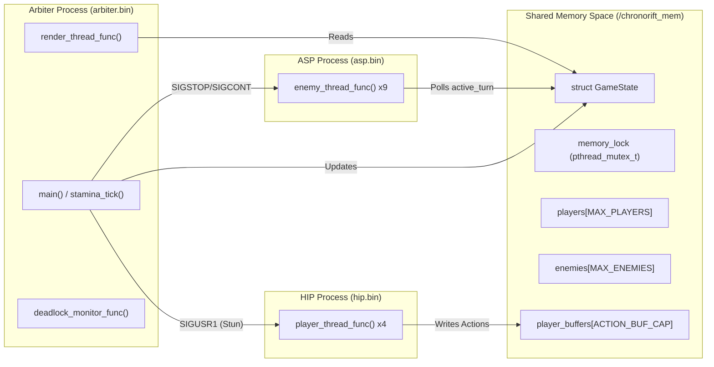

### Data Flow: Action Pipeline

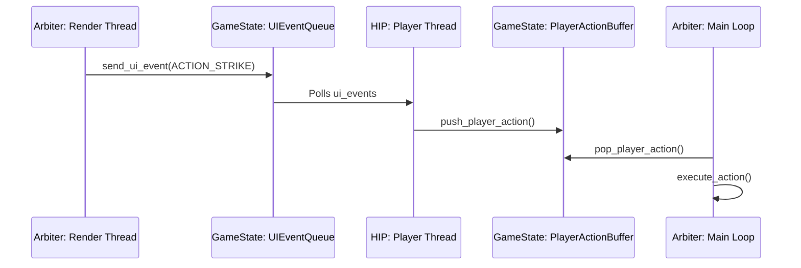

### Core Game Mechanics

| Feature | Description |
| :--- | :--- |
| **Turn Engine** | Uses `stamina` and `speed` to determine the `active_turn`. |
| **Inventory** | Two-tier system: `inventory[20]` (active) and `long_term[50]` (storage). |
| **Artifacts** | Solar Core, Lunar Blade, and Eclipse Relic. Required for Ultimates. |
| **Stun System** | Uses `SIGUSR1` to interrupt HIP/ASP threads via `kill()`. |
| **Ultimate** | Freezes ASP using `SIGSTOP` and resumes with `SIGCONT` via `SIGALRM`. |

---

## 2. Getting Started: Build & Run

### Build System

The project uses a standard `Makefile` to manage compilation of the three core binaries. Each binary links against the SFML library and the POSIX real-time library (`-lrt`) for shared memory operations.

- **Compiler Flags**: `g++` with `-std=c++17` and `-pthread`
- **Libraries**: `lsfml-graphics`, `lsfml-window`, `lsfml-audio`, `lsfml-network`, `lsfml-system`, and `lrt`
- **Shared Source**: `shared/shared_utils.cpp` is compiled into every binary

### Compilation

```bash
make all
```

This builds:
1. `arbiter.bin` — central game engine and renderer
2. `hip.bin` — Human Interface Processor for player input
3. `asp.bin` — Adversary Simulation Process for enemy AI

### Running the System

The **Arbiter must be started first** to initialize shared memory. Then launch HIP and ASP in separate terminals.

```bash
# Terminal 1
./arbiter.bin

# Terminal 2
./hip.bin

# Terminal 3
./asp.bin
```

### Build and Execution Topology

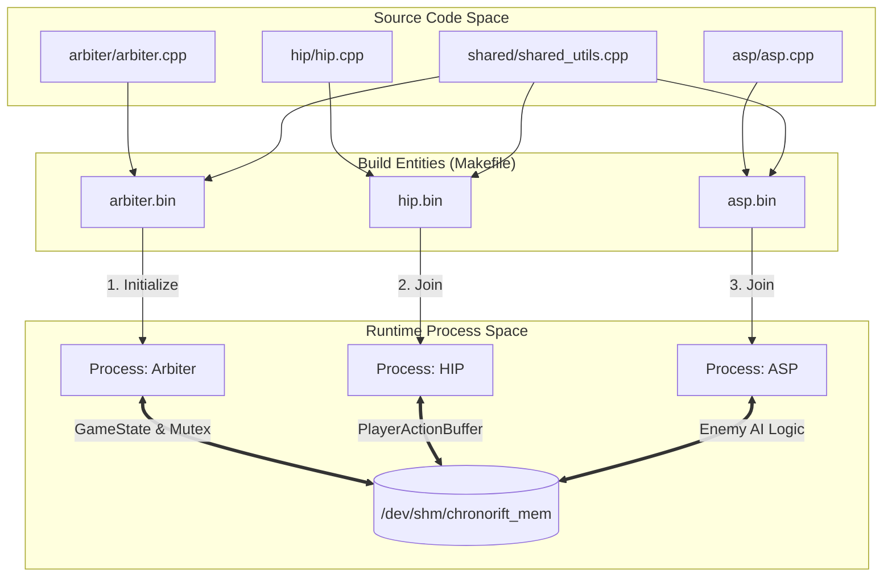

### Docker Development Environment

For environments lacking SFML or C++17 dependencies, a `Dockerfile` is provided based on Ubuntu 22.04.

```bash
# Build the container
docker build -t chrono-rift-dev .

# Run with X11 forwarding (required for SFML window)
xhost +local:docker
docker run -it --rm \
    -e DISPLAY=$DISPLAY \
    -v /tmp/.X11-unix:/tmp/.X11-unix \
    --device /dev/dri:/dev/dri \
    chrono-rift-dev
```

### Shared Utilities

All three binaries depend on `shared/shared_utils.cpp`:

| Function | Purpose |
| :--- | :--- |
| `attach_shared_memory` | Maps the `/chronorift_mem` segment into the process's address space. |
| `install_stun_and_term_handlers` | Sets up signal handling for `SIGUSR1` (stunning) and `SIGTERM` (shutdown). |
| `init_enemy` | Factory function used by the Arbiter to populate the `GameState` with enemy entities. |

---

## 3. System Architecture: Multi-Process Design

Chrono Rift is architected as a distributed system comprising three distinct processes that coordinate to manage a real-time combat simulation.

### Process Roles

| Binary | Process Name | Role | Primary Responsibilities |
| :--- | :--- | :--- | :--- |
| `arbiter` | **Arbiter** | Orchestrator | Owns the GameState, handles SFML rendering, manages the turn engine, and resolves combat logic. |
| `hip` | **HIP** | Input Bridge | Spawns threads for each human player to translate SFML UI events into actionable commands. |
| `asp` | **ASP** | AI Engine | Spawns threads for each enemy to simulate autonomous decision-making and "Stun" mechanics. |

### Process Inter-Connectivity

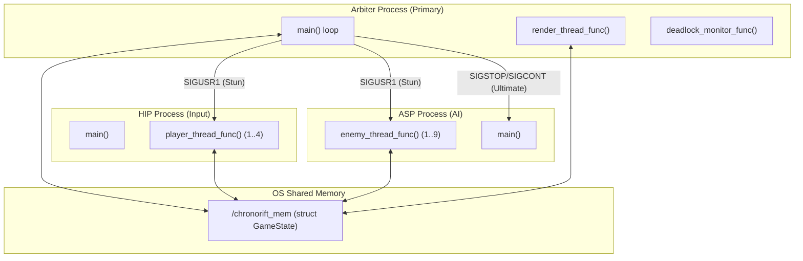

### Shared Memory Communication

The backbone of the architecture is the `GameState` structure. All processes map this structure into their own address space using `mmap`.

**Synchronization Primitives**: Access is protected by `gs->memory_lock` (a `pthread_mutex_t` initialized with `PTHREAD_PROCESS_SHARED`).

**Communication Buffers**:
1. **`UIEventQueue ui_events`**: The Arbiter's rendering thread pushes GUI clicks here. The HIP process polls this queue.
2. **`PlayerActionBuffer player_buffers[MAX_PLAYERS]`**: A ring-buffer per player. HIP pushes validated actions; the Arbiter's main loop pops them.
3. **`pending_action` Handshake**: A single-slot mailbox used by the ASP. The AI thread posts an action and spin-waits until the Arbiter clears it.

### Signal-Based Mechanics

- **Stun (SIGUSR1)**: Arbiter sends `SIGUSR1` to the target process. The receiving thread executes `stun_handler`, which calls `sleep(3)`.
- **Ultimate (SIGSTOP / SIGCONT)**: Arbiter sends `SIGSTOP` to `asp_pid` to freeze the entire ASP process. After a timer (`SIGALRM`), sends `SIGCONT` to resume.

### Data Flow: From Click to Combat Resolution

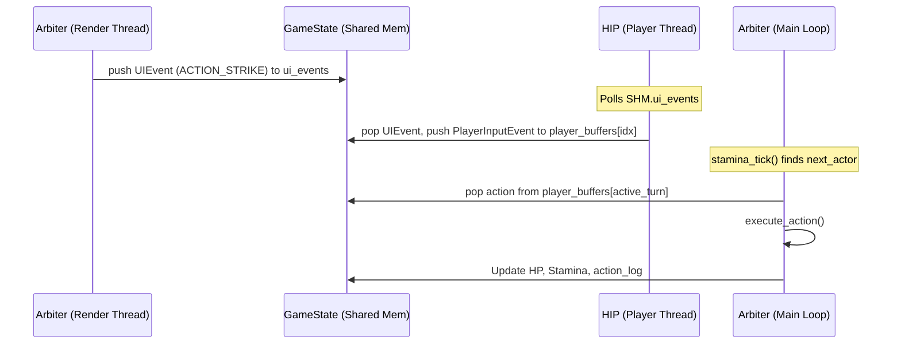

---

## 4. Shared Memory & IPC Layer

The entire game state is housed in a single POSIX shared memory segment named `/chronorift_mem`. The primary structure stored here is `GameState`, which contains all entity data, action buffers, and synchronization primitives.

### IPC Initialization Sequence

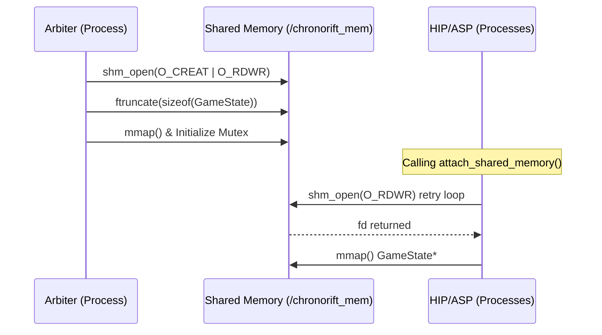

### GameState & Data Structures

The `GameState` struct is the "Single Source of Truth":

- **Entities**: Arrays of `Entity` structs for players and enemies, tracking HP, stamina, and inventory.
- **`PlayerActionBuffer`**: Ring buffers for player inputs.
- **`UIEventQueue`**: A queue for the Arbiter to send visual events back to the UI.
- **Resource Tracking**: Tables for artifact ownership (Solar Core, Lunar Blade, Eclipse Relic) used for the Ultimate ability and deadlock detection.

### Synchronization & Signaling

| Signal | Purpose |
| :--- | :--- |
| `SIGUSR1` | Triggers a 3-second `sleep()` in the receiving thread — simulates "Stun". |
| `SIGSTOP` / `SIGCONT` | Freezes/resumes the entire ASP process during the "Ultimate" time-stop. |
| `SIGALRM` | Drives the 100ms game tick and Ultimate ability timer. |
| `SIGTERM` | Orderly shutdown — sets `running = false` across all processes. |

---

## 5. Arbiter: Game Orchestrator

The **Arbiter** is the central authority of the Chrono Rift system. It functions as the primary state machine, managing game phases, enforcing combat rules, and hosting the SFML-based graphical interface.

### Core Responsibilities

- **State Authority**: Initializes the `GameState` in POSIX shared memory and manages the global `memory_lock`.
- **Rendering Host**: Runs the SFML event loop for visual feedback (animations, UI panels, health bars).
- **Logic Engine**: Executes the main game loop — stamina regeneration, actor priority, action validation.
- **Safety & Resource Management**: Monitors for deadlocks and manages process-level signaling.

### System Entity Map

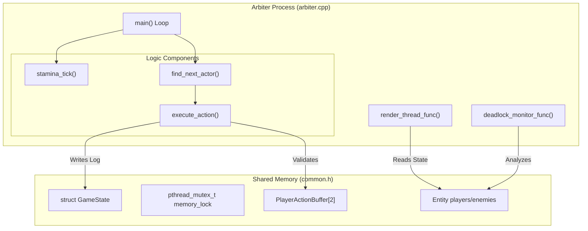

### Interaction with Other Processes

| Target Process | Mechanism | Purpose |
| :--- | :--- | :--- |
| **HIP** | `PlayerActionBuffer` | Arbiter pops actions from `head` while HIP pushes to `tail`. |
| **ASP** | `Entity.active_turn` | Arbiter sets this flag to `true` to signal the AI to make a decision. |
| **ASP** | `SIGSTOP` / `SIGCONT` | Used during the "Ultimate" time-freeze to suspend the entire ASP process. |

---

## 6. HIP: Human Interface Processor

The **HIP** is a dedicated process responsible for bridging player interactions with the SFML GUI and the game's internal logic. It acts as a translation layer that polls UI events from shared memory and forwards them to the Arbiter via synchronized action buffers.

### Input Flow

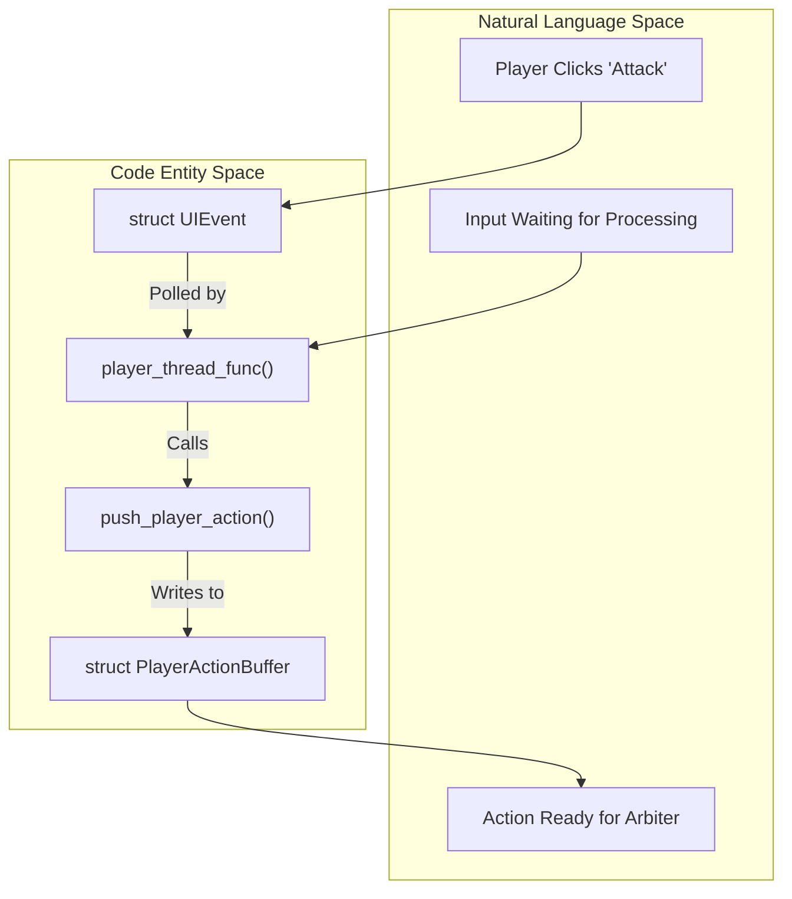

### Threading Model

- **Main Thread**: Initializes shared memory, sets up signal handlers, spawns worker threads, then enters a sleep loop until the game ends.
- **Player Threads (`player_thread_func`)**: Each thread is assigned a specific `player_idx` and independently polls `gs->ui_events` for matching events.

### Thread-to-Process Registration

| Entity | Code Identifier |
| :--- | :--- |
| **HIP Process ID** | `gs->hip_pid` |
| **Individual Player PIDs** | `gs->players[i].pid` |
| **Thread TIDs** | `gs->hip_thread_tids[idx]` |

### The Input Pipeline

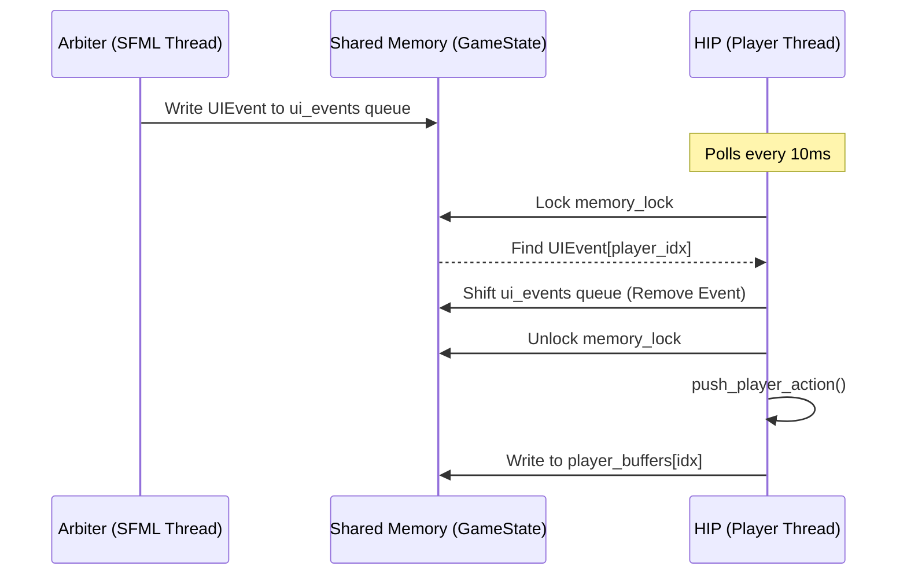

---

## 7. ASP: Adversary Simulation Process

The **ASP** is the dedicated engine for simulating enemy behavior. It operates as an independent process using a **thread-per-enemy model**, where each enemy slot in the `GameState` is managed by a specific POSIX thread.

### Process Architecture

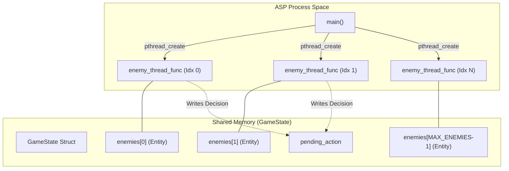

### AI Decision Logic

- **Heuristic**: Enemies follow an "80/20" rule — 80% chance to strike a player, 20% chance to skip the turn.
- **Targeting**: Enemies automatically target the first living player found in `gs->players`.
- **Handshake**: After posting an action, the thread spin-waits until the Arbiter clears `gs->pending_action` back to `ACTION_NONE`.

### Signal Flow

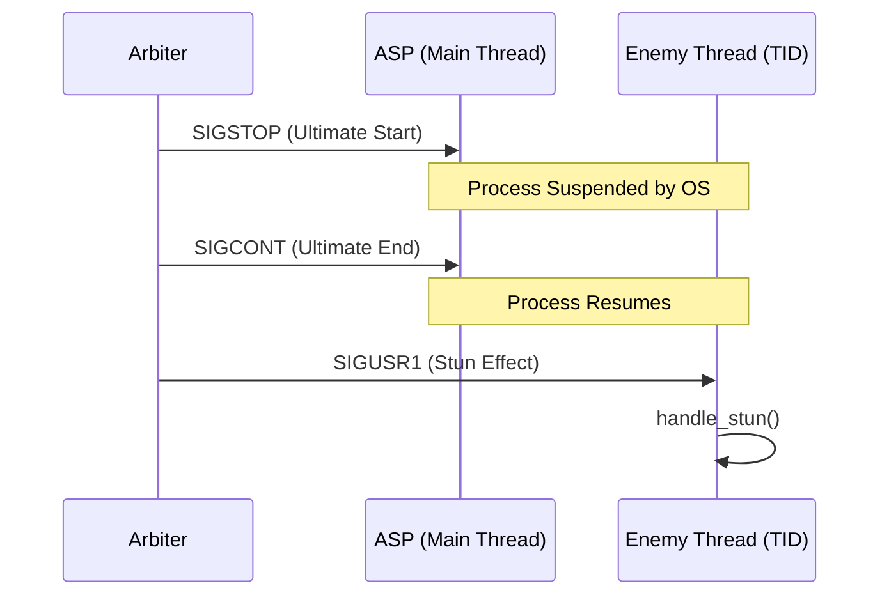

### Data Interaction Summary

| Shared Variable | ASP Role | Purpose |
| :--- | :--- | :--- |
| `gs->active_turn` | Reader | Determines when a specific thread is allowed to act. |
| `gs->pending_action` | Writer/Reader | Posts the chosen `ActionCode` and waits for Arbiter consumption. |
| `gs->action_actor` | Writer | Identifies which enemy index is performing the action. |
| `gs->asp_thread_tids` | Writer | Stores `pthread_t` values so Arbiter can send targeted signals. |
| `gs->is_game_over` | Reader | Termination signal for the thread loops. |

---

## 8. Combat System & Game Mechanics

### Turn Engine & Stamina Model

The game uses a "Stamina Tick" system — entities accumulate progress based on their `speed` stat.

- **Stamina Accumulation**: `stamina_tick()` increments each alive entity's `stamina` by their `speed` value.
- **Turn Threshold**: An entity gains a turn when `stamina` reaches or exceeds `max_stamina` (default 100).
- **Active Actor**: `gs->active_turn` in `GameState` indicates whose turn it is.

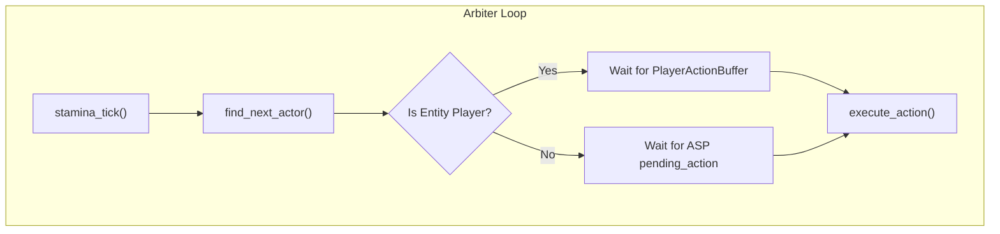

### Action Codes

| Action Constant | Code | Description |
| :--- | :--- | :--- |
| `ACTION_STRIKE` | 1 | Basic attack dealing `Entity.damage` to target. |
| `ACTION_EXHAUST` | 2 | Drains 40 stamina from target and triggers `SIGUSR1` stun. |
| `ACTION_USE_WEAPON` | 3 | Uses a specific weapon from inventory. |
| `ACTION_SWAP_IN` | 4 | Moves a weapon from `long_term` storage to active `inventory`. |
| `ACTION_HEAL` | 5 | Restores 10% of Max HP. |
| `ACTION_SKIP` | 6 | Forfeits turn; stamina is reset to 50% instead of 0. |
| `ACTION_ULTIMATE` | 8 | High-damage time-freeze ability. |

### Weapons & Inventory System

- **Primary Inventory**: `Entity.inventory[20]`
- **Long-Term Storage**: `Entity.long_term[50]`
- **Weapon Drops**: When an enemy is killed, a `WeaponDropState` is triggered, prompting the player to accept or decline a new weapon.

### Artifacts & Special Abilities

- **Global Tracking**: The Arbiter tracks the `holder` index for the Solar Core, Lunar Blade, and Eclipse Relic.
- **The Ultimate**: Requires a player to hold both the Solar Core and Lunar Blade. Triggers `SIGSTOP` on the ASP process to freeze enemies.
- **Stun Mechanics**: Stuns are implemented by sending `SIGUSR1` to the target process and setting the `is_stunned` flag.

### Combat Visuals

- **Lunge Animation**: Triggered via `fire_attack_trigger()`. Frame calculated by `compute_lunge_frame()`.
- **Action Log**: `gs->action_log` is updated by the Arbiter to describe recent events.
- **UI Events**: The Arbiter communicates visual changes back to the HIP via the `UIEventQueue`.

---

## 9. Assets: Sprites & Visual Resources

All graphical assets are located in the `Sprites/` directory.

| Asset Type | File(s) | Usage |
| :--- | :--- | :--- |
| **Players** | `players.png` | Sprite sheet for all player-controlled characters. |
| **Enemies** | `enemy_red_flip.png`, `enemy_blue_flip.png`, `enemy_silver_flip.png` | Textures for different enemy tiers. |
| **Backgrounds** | `backgrounds.png`, `backgrounds_2-5.jpeg` | Dynamic stage backgrounds based on game state. |
| **Effects** | `Attack.png` | Visual overlay for weapon swings/slashes. |

### Visual Resource Flow

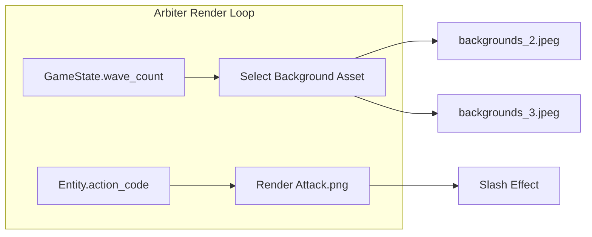

---

## 10. Glossary

| Term | Definition |
| :--- | :--- |
| **Arbiter** | The "Source of Truth" process. Manages the game loop, state transitions, rendering, and deadlock monitoring. |
| **HIP** | Human Interface Processor. Translates GUI interactions into `PlayerActionBuffer` entries. |
| **ASP** | Adversary Simulation Process. Runs one thread per enemy using heuristic AI. |
| **`/chronorift_mem`** | POSIX shared memory segment hosting the `GameState` struct. |
| **`active_turn`** | Integer in `GameState` indicating which entity is currently permitted to act. |
| **`pending_action`** | Handshake variable used by ASP to submit a move; cleared by the Arbiter after processing. |
| **Stun (SIGUSR1)** | Prevents an entity from acting for 3 seconds via `sleep(3)` in `stun_handler`. |
| **Ultimate (Time Freeze)** | `ACTION_ULTIMATE` — uses `SIGSTOP`/`SIGCONT` to freeze the ASP process. |
| **Contiguous Slots** | Weapons occupy a fixed number of slots (`WPN_SLOTS`); `find_contiguous_slots` checks for available space. |
| **Long-term Storage** | 50-slot overflow buffer (`long_term[50]`) for weapons that don't fit in the active inventory. |
| **Artifacts** | `WPN_SOLAR_CORE`, `WPN_LUNAR_BLADE`, `WPN_ECLIPSE_RELIC` — tracked globally for deadlock detection. |
| **Wait-For Graph** | Logic in `deadlock_monitor_func` using `Entity.waiting_for` to detect circular artifact waits. |

### Constants Reference

| Constant | Value | Description |
| :--- | :--- | :--- |
| `MAX_PLAYERS` | 4 | Maximum player entities in `GameState`. |
| `MAX_ENEMIES` | 9 | Maximum enemy entities in `GameState`. |
| `ACTION_STRIKE` | 1 | Basic attack action code. |
| `ACTION_EXHAUST` | 2 | Stamina drain + SIGUSR1 stun. |
| `ROLL_SEED` | 795 | Seed for `rand()` based on student ID. |
| `UI_EVENT_CAP` | 32 | Size of the `UIEventQueue`. |

### Entity Data Structure

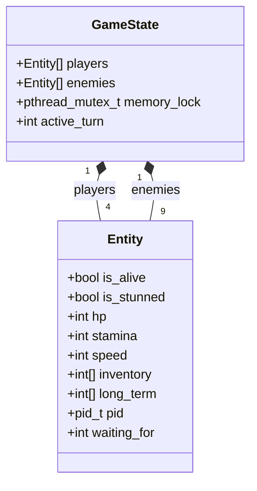
